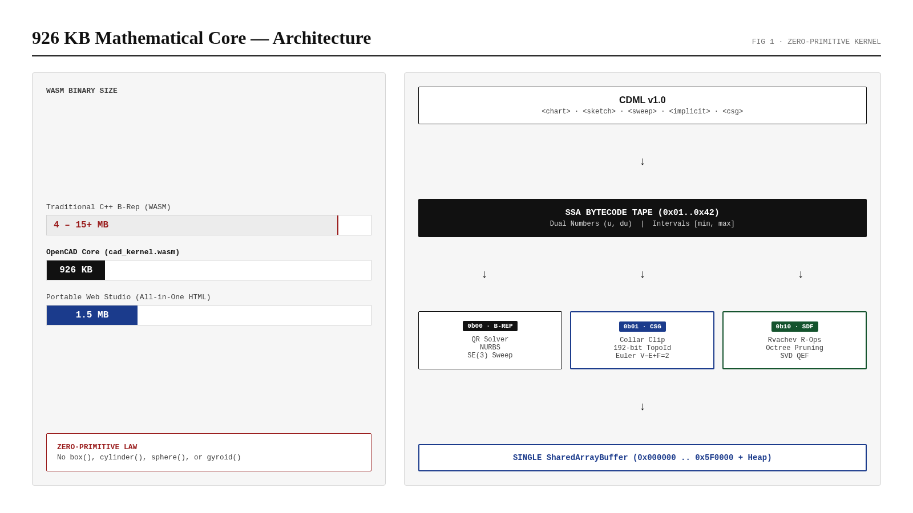
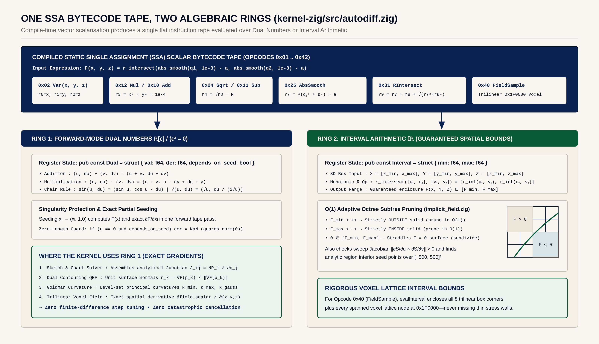
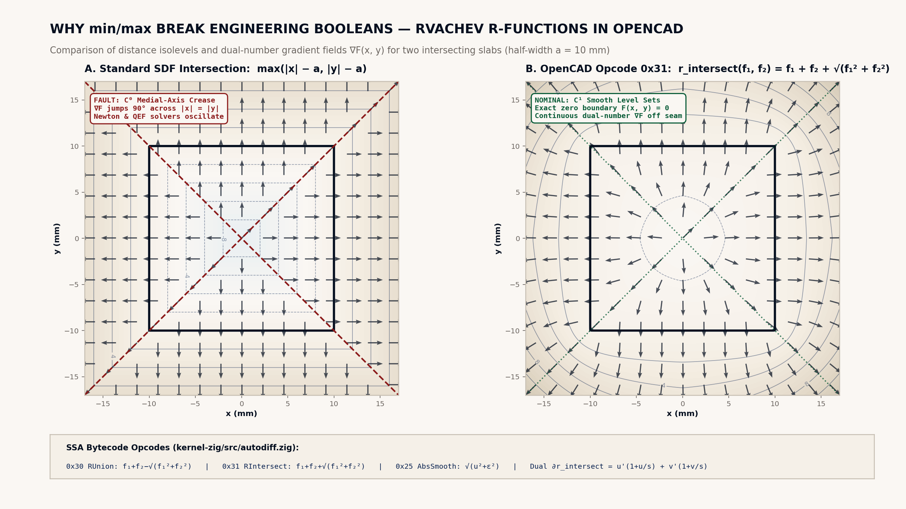
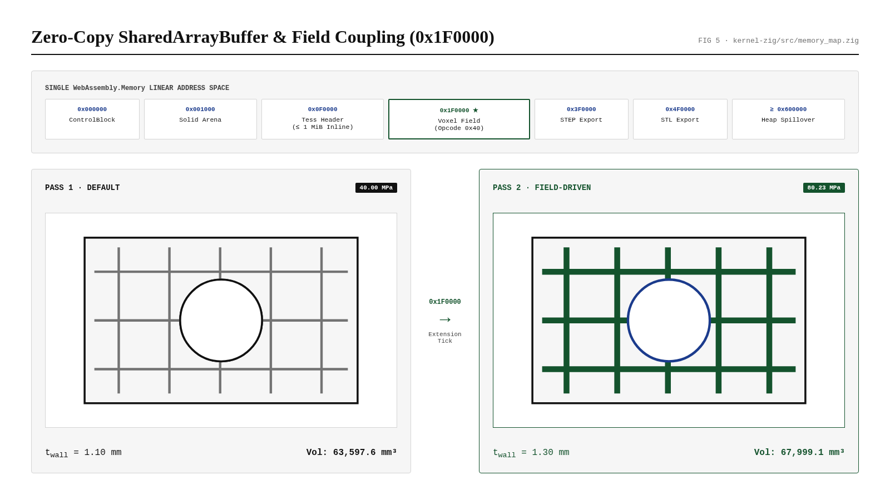

# Inside a 926 KB CAD Kernel: Unifying B-Rep, CSG, and Implicit Fields with One Math Core

Many browser CAD tools compile legacy C++ geometry engines to WebAssembly. That approach often produces binaries between 4 MB and 15 MB before rendering or simulation begins. Mechanical CAD also splits into three separate geometry models:

- **Boundary Representation (B-Rep)** for machined parts.
- **Constructive Solid Geometry (CSG)** for boolean trees.
- **Implicit Signed Distance Fields (SDFs)** for lattices and field-driven parts.

I built **OpenCAD** in Zig and WebAssembly with two goals. First, keep the kernel small enough to run in a browser tab or on an embedded device. Second, unify B-Rep, CSG, and implicit fields under one mathematical engine.

Today, [cad_kernel.wasm](https://github.com/hassaanmaqsood/opencad/blob/main/web-app/public/cad_kernel.wasm) compiles to **926 KB**. The offline single-file web studio (`opencad-portable.html`) is about **1.5 MB**.

To fit a B-Rep modeler, a constraint solver, a CSG bridge, and an implicit mesher into 926 KB, OpenCAD removes every geometric primitive. Inside [kernel-zig/src](https://github.com/hassaanmaqsood/opencad/tree/main/kernel-zig/src), there is no hardcoded `box`, `cylinder`, `sphere`, `rect`, or `gyroid`. The verification script [verify_gates.sh](https://github.com/hassaanmaqsood/opencad/blob/main/scripts/verify_gates.sh) scans the source tree and fails if any primitive generator appears. Every curve, workplane, surface, and solid compiles to the same mathematical core.



---

## 1. One Bytecode Tape, Two Algebraic Rings

In OpenCAD, users author geometry in **CDML v1.0 (Computational Design Markup Language)**. The TypeScript builder in [cdml.ts](https://github.com/hassaanmaqsood/opencad/blob/main/packages/core-sdk/src/cdml.ts) and the Python builder in [bindings/python/opencad](https://github.com/hassaanmaqsood/opencad/tree/main/bindings/python/opencad) also emit CDML XML. Every numeric attribute, constraint residual, sweep trajectory, and scalar field is a mathematical expression.

The kernel does not evaluate text strings in a loop. Instead, [autodiff.zig](https://github.com/hassaanmaqsood/opencad/blob/main/kernel-zig/src/autodiff.zig) compiles each expression into a **Static Single Assignment (SSA) bytecode tape** (`OpCode` values `0x01` through `0x42`). Vector constructs such as `vec2`, `vec3`, `dot`, `cross`, and `norm` have no dedicated opcodes. The compiler expands vector math at compile time into scalar instructions:

```zig
pub const OpCode = enum(u8) {
    Const = 0x01,      Var = 0x02,
    Add = 0x10,        Sub = 0x11,        Mul = 0x12,        Div = 0x13,        Pow = 0x14,
    Sin = 0x20,        Cos = 0x21,        Exp = 0x22,        Log = 0x23,        Sqrt = 0x24,
    AbsSmooth = 0x25,  Abs = 0x26,
    RUnion = 0x30,     RIntersect = 0x31, Lt = 0x32,         Gt = 0x33,         And = 0x34,        Or = 0x35,
    FieldSample = 0x40, Probe = 0x41,     FromId = 0x42,
};
```

The kernel evaluates this single scalar tape over **two algebraic rings** depending on the operation.

### Ring 1: Forward-Mode Dual Numbers (Exact Gradients)

Constraint solving, surface normal calculation, and dual contouring all require derivatives. Finite differences ($\frac{f(x+h)-f(x)}{h}$) require step-size tuning and lose precision near sharp creases.

OpenCAD evaluates the SSA tape over the ring of **dual numbers** $\mathbb{R}[\epsilon]/(\epsilon^2 = 0)$ in [autodiff.zig](https://github.com/hassaanmaqsood/opencad/blob/main/kernel-zig/src/autodiff.zig). Each value is a pair $(u, du)$ with a `depends_on_seed` flag. Every opcode propagates the primal value and the exact analytical derivative in one pass:

$$(u, du) + (v, dv) = (u + v, \quad du + dv)$$

$$(u, du) \cdot (v, dv) = (u \cdot v, \quad v \cdot du + u \cdot dv)$$

$$\sin(u, du) = (\sin u, \quad \cos u \cdot du)$$

Seeding $x_i \to (x_i, 1)$ returns both $F(\mathbf{x})$ and the exact partial derivative $\frac{\partial F}{\partial x_i}$ with zero truncation error. In `Dual.sqrt`, if $u = 0$ while `depends_on_seed` is true, the kernel emits `NaN` for the derivative to catch zero-length vector singularities.

### Ring 2: Interval Arithmetic (Guaranteed Spatial Bounds)

Point sampling alone can miss thin walls when the kernel meshes an implicit field $F(x,y,z) \le 0$ or checks a swept surface.

To prevent missed features, [autodiff.zig](https://github.com/hassaanmaqsood/opencad/blob/main/kernel-zig/src/autodiff.zig) runs the same SSA tape over **interval arithmetic** $\mathbb{I}\mathbb{R}$ (`pub const Interval = struct { min: f64, max: f64 }`). Each coordinate becomes an axis-aligned interval $[x_{\min}, x_{\max}]$. One evaluation returns guaranteed bounds $[F_{\min}, F_{\max}]$ for an entire 3D box:

- If $F_{\min} > \tau$ or $F_{\max} < -\tau$, the zero isosurface cannot cross that octree cell. The mesher prunes the entire subtree in $O(1)$ time.
- During a kinematic sweep, evaluating $\Vert\frac{\partial \mathbf{S}}{\partial u} \times \frac{\partial \mathbf{S}}{\partial v}\Vert$ over parameter intervals checks whether the surface normal collapses to zero (`ERR_SWEEP_SELF_INTERSECT`).



---

## 2. Why `min` and `max` Break Booleans (Rvachev R-Functions)

Many SDF tutorials write boolean union and intersection as $\min(f_1, f_2)$ and $\max(f_1, f_2)$. That shortcut works for raymarching, but it causes failures in computational mechanics.

Along the medial axis where $f_1(\mathbf{x}) = f_2(\mathbf{x})$, `min` and `max` create a discontinuous jump in the gradient ($C^0$ creases). When a Newton-Raphson solver or a Dual Contouring optimizer crosses that seam, the derivative flips sign and convergence degrades.

OpenCAD replaces `min` and `max` with **Rvachev R-functions** in the instruction set (`0x30 RUnion`, `0x31 RIntersect`, and `0x25 AbsSmooth`):

$$\text{r\_union}(f_1, f_2) = f_1 + f_2 - \sqrt{f_1^2 + f_2^2}$$

$$\text{r\_intersect}(f_1, f_2) = f_1 + f_2 + \sqrt{f_1^2 + f_2^2}$$

$$\text{abs\_smooth}(u, \varepsilon) = \sqrt{u^2 + \varepsilon^2}$$

Here is the dual-number implementation in [autodiff.zig](https://github.com/hassaanmaqsood/opencad/blob/main/kernel-zig/src/autodiff.zig):

```zig
pub fn absSmooth(u: Dual, eps: Dual) Dual {
    const s = @sqrt(u.val * u.val + eps.val * eps.val);
    const d = if (s > 1e-15) (u.val * u.der + eps.val * eps.der) / s else 0.0;
    return .{ .val = s, .der = d, .depends_on_seed = u.depends_on_seed or eps.depends_on_seed };
}

pub fn rUnion(u: Dual, v: Dual) Dual {
    const s = @sqrt(u.val * u.val + v.val * v.val);
    const val = u.val + v.val - s;
    const der = if (s > 1e-15)
        u.der * (1.0 - u.val / s) + v.der * (1.0 - v.val / s)
    else
        u.der + v.der;
    return .{ .val = val, .der = der, .depends_on_seed = u.depends_on_seed or v.depends_on_seed };
}

pub fn rIntersect(u: Dual, v: Dual) Dual {
    const s = @sqrt(u.val * u.val + v.val * v.val);
    const val = u.val + v.val + s;
    const der = if (s > 1e-15)
        u.der * (1.0 + u.val / s) + v.der * (1.0 + v.val / s)
    else
        u.der + v.der;
    return .{ .val = val, .der = der, .depends_on_seed = u.depends_on_seed or v.depends_on_seed };
}
```

These functions preserve the exact zero-level set of the boolean boundary while keeping gradients $C^1$-smooth off the seam. Because `r_union` and `r_intersect` are monotonically non-decreasing in both arguments, `Interval.rUnion` and `Interval.rIntersect` evaluate exact interval bounds at endpoints in $O(1)$ time.



---

## 3. Solving Geometry Without Primitives: Charts, Sketches, and Householder QR

Engineers build mechanical parts by constraining 2D geometry on a workplane and sweeping it into 3D. In OpenCAD, even the workplane is not a hardcoded enum. It is a constrained **2-manifold chart** $\Phi: \mathbb{R}^2 \to \mathbb{R}^3$:

$$\Phi(u, v) = \mathbf{p}_0 + u\mathbf{e}_1 + v\mathbf{e}_2$$

The solver computes the basis vectors $(\mathbf{p}_0, \mathbf{e}_1, \mathbf{e}_2)$ from user orientation constraints and orthonormal residual equations. Those equations enforce $\mathbf{e}_2 \cdot \mathbf{e}_2 - 1 = 0$ and $\mathbf{e}_1 \cdot \mathbf{e}_2 = 0$.

A 2D sketch on that chart is a vector of $N$ free scalar parameters $\mathbf{q}$. A system of $M$ algebraic residual equations $\mathbf{R}(\mathbf{q}) = \mathbf{0}$ governs those parameters. Because `sqrt(u)` has an undefined derivative at $u = 0$, sketches can express distance constraints in squared form ($\mathbf{d} \cdot \mathbf{d} - L^2 = 0$). Here is an example from [constrained_bracket.cdml](https://github.com/hassaanmaqsood/opencad/blob/main/examples/constrained_bracket.cdml):

```xml
<chart id="ch_xy">
  <vars>
    <vec3 id="p0" x="0.0" y="0.0" z="0.0" fixed="true"/>
    <vec3 id="e1" x="1.0" y="0.0" z="0.0" fixed="true"/>
    <vec3 id="e2" x="0.0" y="1.0" z="0.0" fixed="false"/>
  </vars>
  <constraints>
    <residual id="u2" expr="dot(e2, e2) - 1.0"/>
    <residual id="or" expr="dot(e1, e2)"/>
    <residual id="pz" expr="dot(e2, vec3(0, 0, 1))"/>
  </constraints>
</chart>
<sketch id="sk_bracket" chart="ch_xy" max-iter="100">
  <vars>
    <point2d id="v0" u="-30.0" v="-30.0"/>
    <point2d id="v1" u=" 30.0" v="-30.0"/>
    <point2d id="v2" u=" 30.0" v=" 30.0"/>
    <point2d id="v3" u="-30.0" v=" 30.0"/>
  </vars>
  <constraints>
    <residual id="cx" expr="v0.u + v1.u"/>
    <residual id="cy" expr="v0.v + v3.v"/>
    <residual id="sy" expr="v2.u + v3.u"/>
    <residual id="h0" expr="v1.v - v0.v"/>
    <residual id="h1" expr="v2.v - v3.v"/>
    <residual id="ot" expr="dot(v1 - v0, v2 - v1)"/>
    <residual id="we" expr="dot(v1 - v0, v1 - v0) - ref(bracket_w)^2"/>
    <residual id="he" expr="dot(v2 - v1, v2 - v1) - ref(bracket_w)^2"/>
  </constraints>
</sketch>
```

To solve $\mathbf{R}(\mathbf{q}) = \mathbf{0}$, `ConstraintSystem` in [constraint_sys.zig](https://github.com/hassaanmaqsood/opencad/blob/main/kernel-zig/src/constraint_sys.zig) executes three steps:

1. Evaluate each residual's SSA tape with dual numbers to assemble the exact analytical Jacobian $\mathbf{J}(\mathbf{q}) \in \mathbb{R}^{M \times N}$, where $J_{ij} = \frac{\partial R_i}{\partial q_j}$.
2. Factor the Jacobian using **Householder QR decomposition with column pivoting**:

$$\mathbf{J}\mathbf{P} = \mathbf{Q}\begin{bmatrix} \mathbf{R}_{11} & \mathbf{R}_{12} \\ \mathbf{0} & \mathbf{0} \end{bmatrix}$$

3. Count the diagonal pivots $\vert R_{ii}\vert > 10^{-10}$ to find the numerical rank $r$.

From that factorization, `getDof` computes the exact **Degrees of Freedom** ($\text{DOF} = N - r$). Then `classifyState` assigns one of five states defined in [constraint_sys.zig](https://github.com/hassaanmaqsood/opencad/blob/main/kernel-zig/src/constraint_sys.zig):

- `Solved (0)`: $\Vert\mathbf{R}(\mathbf{q})\Vert_\infty \le \varepsilon_{\text{lin}}$ and $\text{DOF} = 0$.
- `Under (1)`: $\Vert\mathbf{R}(\mathbf{q})\Vert_\infty \le \varepsilon_{\text{lin}}$ and $\text{DOF} > 0$ (minimum-norm step from initial seed).
- `Over (2)`: $\Vert\mathbf{R}(\mathbf{q})\Vert_\infty \le \varepsilon_{\text{lin}}$ and $M > r$ (consistent dependent constraints).
- `Conflicting (3)`: Non-zero residual projection into the left nullspace $\Vert(\mathbf{Q}^T \mathbf{R})[r..M]\Vert_\infty > \varepsilon_{\text{lin}}$.
- `Diverged (4)`: Exceeded `max_iter` without convergence.

The solver damps updates with Levenberg-Marquardt regularization and applies homotopy sub-stepping when $\Vert\Delta\mathbf{q}\Vert_\infty$ exceeds 25% of the parameter span.

---

## 4. Rational Curves, Kinematic $SE(3)$ Sweeps, and the Starter Toroidal Prism

Once the solver converges on $\mathbf{q}$, `NurbsCurve` in [curve_wire.zig](https://github.com/hassaanmaqsood/opencad/blob/main/kernel-zig/src/curve_wire.zig) reads control points and weights directly from the solved parameter slots:

$$\mathbf{C}(t) = \frac{\sum_{i=0}^{n} N_{i,p}(t)\, w_i\, \mathbf{P}_i}{\sum_{i=0}^{n} N_{i,p}(t)\, w_i}$$

A straight line is degree $p = 1$ with unit weights and knot vector $[0, 0, 1, 1]$. An exact circular arc is degree $p = 2$ with weights $[1, \frac{1}{\sqrt{2}}, 1]$. `NurbsCurve.evalDerivs` evaluates $\mathbf{C}(t)$, $\mathbf{C}'(t)$, and $\mathbf{C}''(t)$ via exact rational quotient derivatives.

To turn closed 2D wires (`role="outer"` and `role="hole"`) into 3D B-Rep solids, OpenCAD does not maintain separate extrude, revolve, and helix engines. Instead, [surface_brep.zig](https://github.com/hassaanmaqsood/opencad/blob/main/kernel-zig/src/surface_brep.zig) implements one **Kinematic $SE(3)$ Sweep** over $v \in [0, 1]$:

$$\mathbf{S}(u, v) = \mathbf{R}(v)\mathbf{C}(u) + \mathbf{d}(v)$$

The kernel evaluates rotations via the Rodrigues exponential map $\mathbf{R}(v) = \exp(\theta(v)[\hat{\boldsymbol{\omega}}]_\times)$ (`rotateRodrigues` in [surface_brep.zig](https://github.com/hassaanmaqsood/opencad/blob/main/kernel-zig/src/surface_brep.zig)) and triangulates end caps with holes using bridge-merged ear clipping:

```zig
pub fn rotateRodrigues(pt: Vec3d, axis: Vec3d, angle_rad: f64) Vec3d {
    if (@abs(angle_rad) < 1e-15) return pt;
    const k = axis.normalize();
    const cos_a = @cos(angle_rad);
    const sin_a = @sin(angle_rad);
    const k_cross_p = k.cross(pt);
    const k_dot_p = k.dot(pt);
    return pt.scale(cos_a).add(k_cross_p.scale(sin_a)).add(k.scale(k_dot_p * (1.0 - cos_a)));
}

pub fn evalTrajectoryPoint(
    local_u: f64, local_v: f64,
    frame_p0: Vec3d, frame_e1: Vec3d, frame_e2: Vec3d,
    step: TrajectoryStep,
) Vec3d {
    const c_u = frame_p0.add(frame_e1.scale(local_u)).add(frame_e2.scale(local_v));
    const rotated = rotateRodrigues(c_u, step.axis, step.angle_rad);
    return rotated.add(step.translation);
}
```

- **Linear extrusion:** $\mathbf{R}(v) = \mathbf{I}$ and $\mathbf{d}(v) = (0, 0, H v)^T$.
- **Revolve or helix:** Coupled rotation $\mathbf{R}_z(\theta v)$ and axial translation $\mathbf{d}(v) = (0, 0, p v)^T$. On rotating sweeps, [evaluator.zig](https://github.com/hassaanmaqsood/opencad/blob/main/kernel-zig/src/cdml/evaluator.zig) scales station count at 16 steps per $2\pi$ revolution (up to `1025` steps) to prevent aliasing. Large sweeps that exceed 1 MiB automatically spill onto the dynamic WASM heap above `0x600000`.
- **Rolling-ball edge fillets:** `solid_envelope_fillet` in [surface_brep.zig](https://github.com/hassaanmaqsood/opencad/blob/main/kernel-zig/src/surface_brep.zig) selects edges through geometric predicates such as `abs(tz) > 0.999 and x^2 + y^2 > ref(infill_r)^2`. It builds tangent canal surfaces of radius $r$ and returns `ERR_FILLET_RADIUS_COLLAPSE` (`0x0402`) when $r \cdot \kappa_{\text{edge}} \ge 1 - \varepsilon_{\text{lin}}$.

Meanwhile, the default starter model loaded in the web studio (`DEFAULT_TORUS_CDML` in [main.ts](https://github.com/hassaanmaqsood/opencad/blob/main/web-app/src/main.ts)) shows how the implicit side handles twisted geometry. It defines a twisted square-section toroidal ring with a flat $z \ge 0$ build-plate base in 28 lines of CDML using `r_intersect` and `abs_smooth`:

```xml
<implicit id="logo_torus">
  <domain xmin="-38.0" xmax="38.0" ymin="-38.0" ymax="38.0" zmin="0.0" zmax="22.0"
          octree-depth="5" qef-reg="1e-4"/>
  <def name="r_xy" expr="sqrt(x^2 + y^2 + 1e-4)"/>
  <def name="u"    expr="r_xy - ref(R)"/>
  <def name="w"    expr="z - ref(z_c)"/>
  <def name="q1"   expr="(u * x + w * y) / r_xy"/>
  <def name="q2"   expr="(w * x - u * y) / r_xy"/>
  <def name="d_tube"
    expr="r_intersect(abs_smooth(q1, 1e-3) - ref(a), abs_smooth(q2, 1e-3) - ref(a))"/>
  <field expr="r_intersect(d_tube, 0.0 - z)"/>
</implicit>
```


---

## 5. Bridging B-Rep, CSG, and Implicit Fields

All three geometry representations sit behind a single 64-bit `solid_t` handle. Its top two bits `[63:62]` tag the active representation:

- `0b00`: Evaluated B-Rep solid (`solid_brep_store`).
- `0b01`: Lazy CSG boolean tree node (`csg_store`).
- `0b10`: Implicit scalar field (`implicit_store`).

### Interval-Pruned Octree & Jacobi SVD Dual Contouring

Implicit leaves never store static meshes. When evaluated, [implicit_field.zig](https://github.com/hassaanmaqsood/opencad/blob/main/kernel-zig/src/implicit_field.zig) subdivides the domain into an interval-pruned octree (default `octree_depth = 5`, or $32^3$ leaf cells, and up to depth 6 in [flange_normative.cdml](https://github.com/hassaanmaqsood/opencad/blob/main/examples/flange_normative.cdml)). It finds edge zero-crossings via safeguarded secant/bisection root-finding and places one dual vertex $\mathbf{v}$ per active cell by minimizing the regularized **Quadratic Error Function (QEF)**:

$$\text{QEF}(\mathbf{v}) = \sum_k \big(\hat{\mathbf{n}}_k \cdot (\mathbf{v} - \mathbf{p}_k)\big)^2 + \lambda \Vert\mathbf{v} - \bar{\mathbf{p}}\Vert^2$$

In [implicit_field.zig](https://github.com/hassaanmaqsood/opencad/blob/main/kernel-zig/src/implicit_field.zig), `solveQefSvd3x3` runs a 15-step cyclic Jacobi eigendecomposition to diagonalize the $3 \times 3$ normal matrix $\mathbf{A} = \mathbf{V}\boldsymbol{\Lambda}\mathbf{V}^T$. It classifies the local feature rank: 1 for a smooth face, 2 for a sharp crease, and 3 for a corner. Then it solves the truncated SVD pseudoinverse and projects the vertex onto $F(\mathbf{x}) = 0$ with 4-step damped Newton-Gradient refinement.

### Straddling-Triangle CSG Subdivision & 192-Bit `TopoId`

When a CSG boolean combines a B-Rep solid and an implicit lattice (`materializeCsgNode` in [surface_brep.zig](https://github.com/hassaanmaqsood/opencad/blob/main/kernel-zig/src/surface_brep.zig)), whole-triangle culling would leave jagged edges. Instead, OpenCAD evaluates the opposing solid's signed distance at each triangle vertex with a signed collar tolerance (`collar_tol = 1e-6`). It subdivides straddling triangles along the $F(\mathbf{x}) = 0$ curve via `findEdgeZeroCrossing`. Then it welds shared seam vertices (`addWeldedCsgVertex`).

The kernel checks every B-Rep solid against the **Euler–Poincaré manifold equation**:

$$V - E + F - (L - F) - 2(S - G) = 0$$

Every triangle also carries a deterministic **192-bit `TopoId`** (`[3]u64` in [topo_id.zig](https://github.com/hassaanmaqsood/opencad/blob/main/kernel-zig/src/topo/topo_id.zig)):

```zig
pub const TopoId = extern struct {
    words: [3]u64 = [_]u64{ 0, 0, 0 },

    pub fn init(feature_hash: u64, branch_hash: u64, subshape_type: u8, flags: u8, split_gen: u32) TopoId {
        const w2: u64 = @as(u64, subshape_type & 0xF) |
            (@as(u64, flags & 0xFF) << 4) |
            (@as(u64, split_gen) << 12);
        return .{ .words = [_]u64{ feature_hash, branch_hash, w2 } };
    }
};

pub fn h64(id_str: []const u8) u64 {
    var digest: [32]u8 = undefined;
    std.crypto.hash.sha2.Sha256.hash(id_str, &digest, .{});
    return std.mem.readInt(u64, digest[0..8], .big);
}
```

- **Word 0:** First 64 bits (`h64`) of the SHA-256 hash of the originating XML element `id`.
- **Word 1:** First 64 bits (`h64`) of the SHA-256 hash of the generating curve or branch `id`.
- **Word 2:** Sub-shape type (`Vertex`, `Edge`, `Wire`, `Face`, `Shell`, `Solid`), topology flags (`PRESERVE`, `BOUNDARY`, `ANALYTIC`, `IMPLICIT_INTERFACE`), and a 32-bit split counter.

Downstream fillets and probes select faces through differential predicates such as `from_id('c_bore') and abs(k_gauss) < 1e-9` instead of fragile array indices.

### Exact Volume Integration

For any resolved solid, `BRepSolid.computeEnclosedVolume` in [surface_brep.zig](https://github.com/hassaanmaqsood/opencad/blob/main/kernel-zig/src/surface_brep.zig) integrates enclosed volume over the closed triangle boundary via the discrete **Divergence Theorem**:

$$V = \left\vert \frac{1}{6} \sum_{t=0}^{T-1} \mathbf{p}_{0,t} \cdot (\mathbf{p}_{1,t} \times \mathbf{p}_{2,t}) \right\vert$$

---

## 6. Direct Simulation Coupling via Zero-Copy Shared Memory

Most browser CAD tools isolate geometry and simulation in separate heaps and pass JSON or files between them. OpenCAD allocates **one `WebAssembly.Memory` (`SharedArrayBuffer`)** shared by `cad_kernel.wasm`, external WASM solvers, and the Three.js worker bridge ([memory_map.zig](https://github.com/hassaanmaqsood/opencad/blob/main/kernel-zig/src/memory_map.zig)):

| Offset Range | Constant | Purpose |
| :--- | :--- | :--- |
| `0x000000 .. 0x000040` | `CONTROL_BLOCK_OFFSET` | 64-byte `ControlBlock` (`magic = 0x4F434144` `"OCAD"`, `version = 2`, arena offsets, `tess_generation_counter`). |
| `0x001000 .. 0x0F0000` | `SOLID_ARENA_OFFSET` | Persistent solid metadata, B-Rep tables, CSG trees, and SSA tapes. |
| `0x0F0000 .. 0x1F0000` | `TESS_BUFFER_OFFSET` | Pinned 128-byte header (`0x0F0000..0x0F0080`) plus inline `f32`/`u32`/`TopoId` payload up to `1 MiB` (`0x0F0080..0x1F0000`). |
| `0x1F0000 .. 0x3F0000` | `FIELD_BUFFER_OFFSET` | 3D voxel scalar and vector fields written by external WASM extensions (`extension_tick`). |
| `0x3F0000 .. 0x4F0000` | `STEP_EXPORT_OFFSET` | Welded ISO-10303-21 AP214 STEP `CLOSED_SHELL` output buffer ([tess_export.zig](https://github.com/hassaanmaqsood/opencad/blob/main/kernel-zig/src/tess_export.zig)). |
| `0x4F0000 .. 0x5F0000` | `STL_EXPORT_OFFSET` | Binary and ASCII STL output buffer. |
| `>= 0x600000` | `HEAP_BASE_OFFSET` | Reusable 8-byte aligned heap spillover buffer for meshes exceeding `1 MiB` (`> ~21.8k` triangles). |

To handle dense geometry without overflowing into `0x1F0000`, [tess_export.zig](https://github.com/hassaanmaqsood/opencad/blob/main/kernel-zig/src/tess_export.zig) uses a **hybrid fixed/dynamic header-payload layout**. The 128-byte header always stays pinned at `0x0F0000`. Meshes up to `0x0FFF80` bytes (`1,048,448` bytes) write inline at `0x0F0080`. Larger meshes allocate a reusable 8-byte aligned slice above `0x600000`, write those heap addresses into `pos_offset`..`face_offset`, and set `is_heap_spillover = 1` at `0x0F0050`. All JS and Zig readers dereference those header pointers unchanged.

Inside CDML, an expression can call `field_scalar(slot, x, y, z, default)` (`OpCode.FieldSample = 0x40`). In [autodiff.zig](https://github.com/hassaanmaqsood/opencad/blob/main/kernel-zig/src/autodiff.zig), `sampleFieldTrilinearDual` samples the shared Field Buffer at `0x1F0000` with trilinear interpolation and exact trilinear dual derivatives.

Here is how [flange_normative.cdml](https://github.com/hassaanmaqsood/opencad/blob/main/examples/flange_normative.cdml) and [test_canary_extension.mjs](https://github.com/hassaanmaqsood/opencad/blob/main/scripts/test_canary_extension.mjs) couple a 3D stress field to a gyroid lattice core in shared memory:

```xml
<probe id="mean_bore_stress"
       type="face-mean"
       target="solid_flange"
       face-predicate="from_id('c_bore') and abs(k_gauss) < 1e-9"
       quantity="field_scalar(0, x, y, z, 40.0)"/>

<implicit id="solid_gyroid">
  <domain xmin="-45" xmax="45" ymin="-45" ymax="45" zmin="0" zmax="16"
          octree-depth="6" qef-reg="1e-4"/>
  <def name="omega" expr="2 * PI / ref(period)"/>
  <def name="g"
    expr="sin(omega*x)*cos(omega*y) +
          sin(omega*y)*cos(omega*z) +
          sin(omega*z)*cos(omega*x)"/>
  <def name="t_wall" expr="0.9 + 0.005 * probe('mean_bore_stress')"/>
  <field expr="abs_smooth(g, 1e-4) - (0.5 * omega * t_wall)"/>
</implicit>
```

In [test_canary_extension.mjs](https://github.com/hassaanmaqsood/opencad/blob/main/scripts/test_canary_extension.mjs), `cad_kernel.wasm` and `ext_field_canary.wasm` attach to the same `WebAssembly.Memory`:

1. **Pass 1 (before `extension_tick`):** Slot 0 holds no data yet, so `mean_bore_stress` returns the default `40.0 MPa` and `housing_volume` measures `63,597.60 mm³`.
2. **Canary Extension Tick:** `ext_field_canary.wasm` writes a 3D stress field into `0x1F0000`.
3. **Pass 2 (re-evaluation):** `mean_bore_stress` reads `80.23 MPa` from the bore faces. The gyroid wall thickness `t_wall` increases automatically, raising `housing_volume` to `67,999.08 mm³` without a cycle in the CDML document graph.



---

## 7. Where It Still Hurts (Current Experimental Limits)

The 9 verification gates in [verify_gates.sh](https://github.com/hassaanmaqsood/opencad/blob/main/scripts/verify_gates.sh) and 198 native Zig unit tests pass with zero memory leaks. In addition, [test_1000_models.mjs](https://github.com/hassaanmaqsood/opencad/blob/main/scripts/test_1000_models.mjs) tests over 1,000 CDML models. Even so, five areas remain experimental in the current codebase:

1. **Nonlinear Constraint Solver Sensitivity:** The Householder QR and Levenberg-Marquardt solver in [constraint_sys.zig](https://github.com/hassaanmaqsood/opencad/blob/main/kernel-zig/src/constraint_sys.zig) handles orthogonal profiles and convex shapes well. However, sketches with over-constrained dimensions or near-collinear tangent lines can still fail to converge.
2. **Coplanar CSG Booleans and Hybrid Collar Seams:** The kernel subdivides straddling triangles with a signed collar (`collar_tol = 1e-6` in [surface_brep.zig](https://github.com/hassaanmaqsood/opencad/blob/main/kernel-zig/src/surface_brep.zig)). This step cleans up transverse intersections such as cylindrical bores through lattices. However, coplanar faces and grazing tangent contacts can still produce sliver triangles or mesh seam errors.
3. **Rolling-Ball Fillets at High-Curvature Apex Corners:** Constant-radius rolling-ball fillets work on uniform convex and concave sweep edges and cap boundaries (`filletSweptSolid` in [surface_brep.zig](https://github.com/hassaanmaqsood/opencad/blob/main/kernel-zig/src/surface_brep.zig)). Multi-edge apex corners and variable-radius sweeps with high curvature remain unfinished.
4. **Multi-Field Metric Distortion:** Composing several R-function branches with external voxel fields can push $\vert\nabla F\vert$ away from $1$. Without periodic re-normalization, wall-thickness offsets can drift on deep composition trees.
5. **Boolean Thread Cutting (`cad_op_thread`):** Fastener models in CDML build threads through revolved ridge profiles or helical `SE(3)` sweeps. However, the standalone C-ABI function `cad_op_thread` in [main.zig](https://github.com/hassaanmaqsood/opencad/blob/main/kernel-zig/src/main.zig) remains a pass-through stub until helical B-Rep boolean cutting becomes available.

---

## 8. What Is Next

The current roadmap in [README.md](https://github.com/hassaanmaqsood/opencad/blob/main/README.md) focuses on five engineering tracks:

1. **Procedural CDML Scripting:** Add `<for>`, `<while>`, `<if>`, `<else>`, and reusable macros so CDML becomes Turing-complete for gear teeth, heat sinks, and parametric arrays.
2. **In-Kernel 2D Software Renderer and Vector Export:** Finish the 2D hidden-line projection pipeline in [kernel-zig/src/cam_hlr](https://github.com/hassaanmaqsood/opencad/tree/main/kernel-zig/src/cam_hlr) to render headless test snapshots. This pipeline will also export SVG and DXF drawings with visible, hidden, and centerline layers.
3. **Dynamic Section Views:** Add a `<section-view>` tag in CDML and an interactive 3D section-clipping plane in [web-app](https://github.com/hassaanmaqsood/opencad/tree/main/web-app).
4. **Interactive Documentation:** Build an MDN-style reference guide where every CDML element and mathematical operator runs live inside an embedded `<opencad-viewer>` component ([element.ts](https://github.com/hassaanmaqsood/opencad/blob/main/packages/core-sdk/src/element.ts)).
5. **Desktop 3D Software Integration:** Build plugins to bring CDML models directly into Blender Geometry Nodes, FreeCAD feature trees, and KiCad enclosure workflows.

You can inspect the code, run the verification gates, or test the studio in your browser:

- **GitHub Repository & Releases:** [https://github.com/hassaanmaqsood/opencad](https://github.com/hassaanmaqsood/opencad)
- **Live Web Studio:** [https://hassaanmaqsood.github.io/opencad/](https://hassaanmaqsood.github.io/opencad/)

If you work on geometry kernels, constraint solvers, or implicit meshing, please inspect the dual-number pipeline, R-function composition, and hybrid CSG collar clipping. I welcome your technical feedback.
